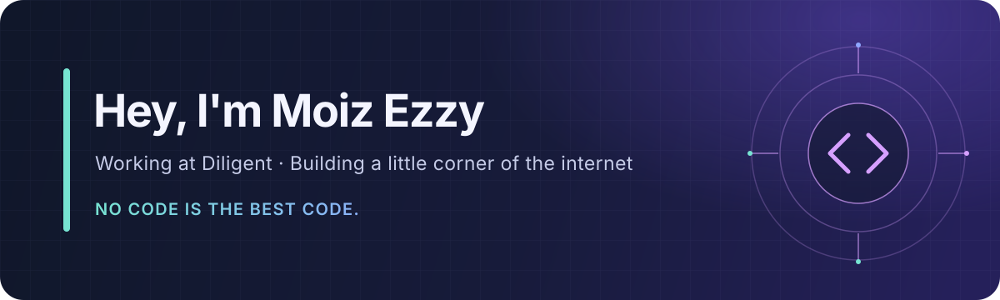

### Welcome to my GitHub ✨

---

## 👋 About me

I’m **Moiz Ezzy**, and I work at **Diligent**. This profile is my little corner to share projects, ideas, and things I find interesting. I believe the best solutions keep things simple.

## 📈 GitHub dashboard

## 🤝 Say hello

Have something cool to share? I'd love to connect — [find me on LinkedIn](https://in.linkedin.com/in/ezzy-moiz).

---

*Thanks for stopping by. Stay curious, keep it simple, and have a great day! ✨*

