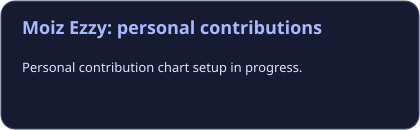
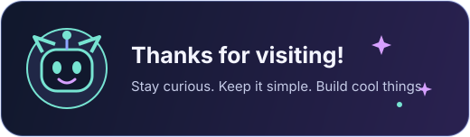

### Senior SRE at Diligent · Founder of [Maskangrid](https://maskangrid.com) ✨

---

## 👋 About me

I’m **Moiz Ezzy**, a **Senior SRE at Diligent** and the **founder of [Maskangrid](https://maskangrid.com)**. I enjoy making infrastructure and software work smoothly, and believe the best solutions keep things simple.

## 🧰 Languages, platforms & tools

My favorite stack spans cloud, containers, programming, and infrastructure automation:

**Infrastructure as Code · Cloud · SRE · Automation**

## 📈 GitHub dashboard

## 🧪 Projects, experiments & open source

Take a look through my [public repositories](https://github.com/dil-mezzy?tab=repositories) and see what catches your eye.

## 🤝 Connect with me

Have something cool to share? I'd love to connect.

---

*Thanks for stopping by. Stay curious, keep it simple, and have a great day! ✨*

